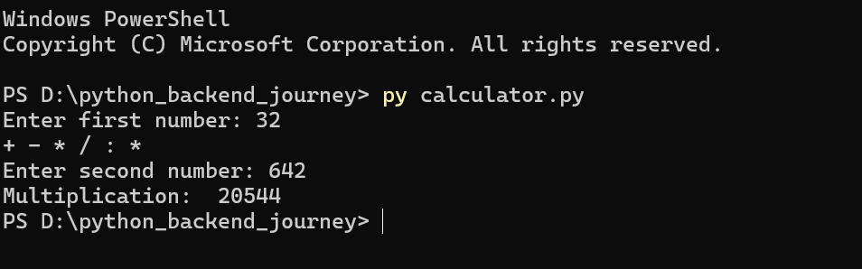

# python-learning-journey
My Python learning exercises and beginner programming projects.
# Simple Python Calculator

## Overview
A beginner-friendly calculator built with Python. It performs basic arithmetic operations and handles common input errors.

## Features
- Addition
- Subtraction
- Multiplication
- Division
- Division-by-zero handling
- Basic invalid-input handling

## Technologies
- Python

## How to Run
1. Install Python.
2. Download or clone this repository.
3. Open a terminal in the project folder.
4. Run:

```bash
python calculator.py
```

## Learning Objectives
This project practices variables, user input, conditional statements, arithmetic operators, and exception handling.

## Future Improvements
- Add a loop for repeated calculations.
- Add more mathematical operations.
- Improve the user interface.

## Screenshot


